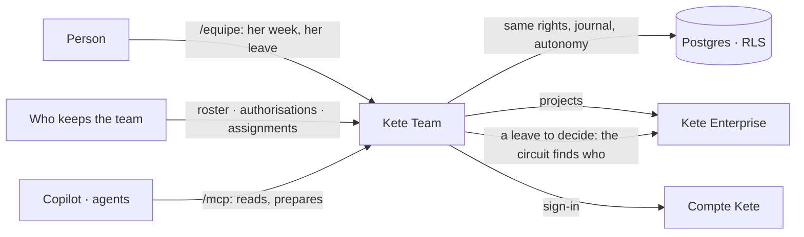

# Kete Team

Who is there, what each one is authorised to do, where each one works — and the month's elements
for the pay. One of the four apps behind the center, Kete Enterprise (doctrine D-048).

Kete Team keeps no project of its own: projects are the center's (D-047). It adds what the center
does not hold about people at work: the authorisations that expire, what each project requires,
who is assigned where, who is away, and how each week's days split between projects. It computes
no pay: it gives the accountant the month's elements.



## Where it stands

`docs/ROADMAP.md` says what is built and what is proven.

| Part                              | State                                                             |
| --------------------------------- | ----------------------------------------------------------------- |
| Roster, authorisations, assignments | Built (spec 001): no assignment without a valid authorisation   |
| Leave                             | Built (spec 001): the center's circuit, or decided here           |
| Time by project                   | Built (spec 001): one answer a week; the month's elements         |
| Advances on salary                | Later: they are money, and belong with Kete Finance's advances    |

## Run locally

```bash
# Once per machine: a GitHub token with read:packages, kept in your user configuration.
pnpm config set "//npm.pkg.github.com/:_authToken" <token>
pnpm install
cp .env.example .env   # then fill it: database, Compte Kete registration, session secret
pnpm db:migrate
pnpm dev               # http://localhost:3400
pnpm worker            # in another terminal: e-mails and events
```

To look at the screens without a Compte Kete nor a center:

```bash
pnpm demo              # http://localhost:3421 — a small team at work, in a throwaway schema
```

`pnpm demo` needs only the two test addresses of `.env` (`KETE_TEST_OWNER_URL`,
`KETE_TEST_APP_URL`). It opens as the owner; `http://localhost:3421/hr`, `/lead` and `/staff`
open as the roles of the trade. It runs without a center: its two projects are written by the
demonstration, and every leave is decided here.

## Test

```bash
pnpm test              # a Neon "test" branch, or KETE_TEST_POSTGRES=container
pnpm typecheck
```

## Deploy

The repository's secret `KETE_PACKAGES_TOKEN` (read:packages) lets CI read kete-core's packages;
the image receives it as the build secret `node_auth_token`. One image, two roles (doctrine
ARCHITECTURE_APP §9): the web process (`pnpm start`, migrations at start-up) and the worker
(`pnpm worker`). An operator registers the app at the Compte Kete (client id and secret), declares
it in Kete Cockpit (its events key) and in the organization's Kete Enterprise (its manifest).
