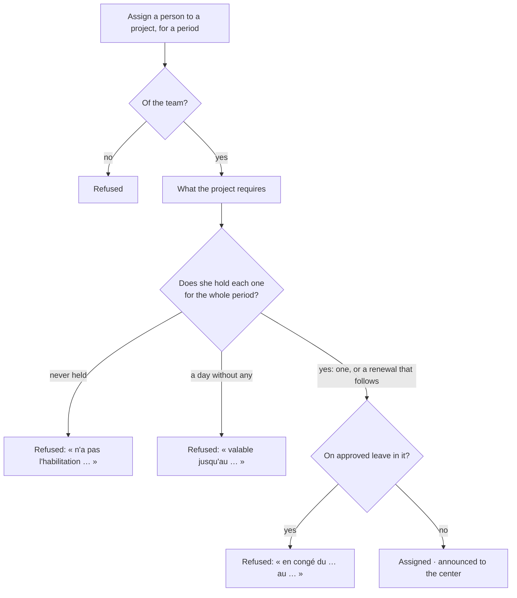

# Spec 001 — The team at work

Step **H1** of the plan (`docs/ROADMAP.md`): the roster, authorisations that expire, what each
project requires, assignments, leave, and time by project in one answer a week.

## Why

An electrical clearance that expired last month is found the day of the accident, or the day the
client's inspector asks for it at the gate. It was written somewhere — in a binder, in someone's
memory — and nothing stood between that paper and the planning. The same goes for a technician
planned on a site the week he is on leave. And nobody knows what a job cost in days, because
nobody fills a timesheet.

## What it gives

- **The roster**: who is of the team, by her Compte Kete account. Whoever asks a leave or answers
  her week joins it by herself.
- **Authorisations**: the organization names the kinds it tracks; each person's are recorded with
  their validity and their proof. **Those that expire within 60 days** are said to who keeps the
  team, and to the person — unless they were renewed.
- **What a project requires** of whoever works on it: a list of kinds, kept once per project.
- **An assignment** — a person, a project, a period — is **refused when she does not hold, for
  the whole period, every authorisation the project requires**. Authorisations that overlap or
  follow each other without a day between count as one: a renewal continues what it renews. A day
  without any is a day she may not work. The refusal names the authorisation, the person, and
  until when what she holds is valid. An assignment may be ended earlier, never made longer.
- **Leave**: she asks a kind and dates; the working days are counted (Monday to Friday). It goes
  to **the center's circuit** for `leave` — which finds her manager, interim included — or, when
  the organization has none or there is no center, is decided here by who may approve leave,
  never by who asked. Sent back, she corrects it. **An approved leave refuses an assignment** on
  its days.
- **Time by project, in one answer a week**: her page shows the projects she is assigned to this
  week and asks how many days on each, in days and half-days — seven at most. A second answer
  replaces the first.
- **The month's elements**: per person, days by project, approved leave by kind, weeks without an
  answer — what the accountant needs. No pay is computed.
- **Four permissions**: be of the team (`team:member`), read everyone's (`team:read`), keep the
  team (`team:manage`), decide a leave here (`team:approve`). An agent reads and prepares; the
  rule that refuses an assignment applies to what it prepared.
- **Screens** under `/equipe`: her page; the people; a person; assignments and requirements; the
  month.

## What stays for later

- **Advances on salary**: they are money — asked here, paid and deducted with Kete Finance's
  advances. Not built.
- Public holidays, and the balance of annual leave a person is entitled to.
- The cost of a day: time by project is in days, not in money; a project's labour cost is not
  sent to the center.
- The center's directory as a list: a person is added by her account's identifier, or joins by
  her first gesture.
- A reminder sent before an authorisation expires (the worker, WhatsApp and Telegram).
- A team member seeing the projects she is not assigned to; a project's lead assigning her own
  team.

## Proof

- `tests/team.test.ts` (18): **a person without a valid authorisation cannot be assigned** —
  refused when she never held it, with its name; refused when it ends before the work does, with
  the day; assigned for the days she is covered, and for the whole period once renewed from the
  day after; never made longer; the same for what an agent prepared. Around it: a leave through
  the center's circuit with its working days; an approved leave keeps a person off a project; a
  leave decided here is never decided by who asked, and is corrected when sent back; a week
  answered once, in halves, seven days at most; the month's elements; who reads what; RLS; the
  manifest.
- `tests/complete.test.ts` (7): the template's own proofs, on this app.
- Seen in the demonstration (`pnpm demo`): her page, the roster with an authorisation that
  expires, assignments and what each project requires, the month.
- Not seen: a leave decided in a real Kete Enterprise; the test plays the center.
