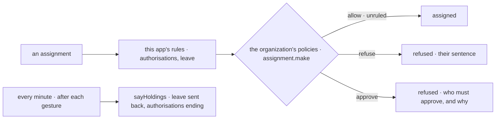

# Spec 004 — Kete Team on the living model

Step **A5** of Kete's release (the doctrine's `FEUILLE_DE_ROUTE.md`; kete-core spec 114; Kete
Enterprise spec 091). The author's go came on 2026-10-17 (« Passe à A5 : les quatre apps du centre
sur le modèle unifié »).

## Why

A leave sent back and an authorisation about to expire waited in Kete Team alone: never in « Pour
moi », never relayed. A policy written at the center (« seul le responsable du projet y affecte »)
did not decide an assignment made here — by a person or by her agent.

## Requirements

- **FR-001 — An assignment through the policies.** Once this app's own rules pass (what the
  project requires, leave), an assignment is an `assignment.make` on its project with its days.
  `refuse` stops it with the policies' sentences; `approve` stops it saying who must approve —
  their names in the roster — and why; `allow` or `unruled` assigns.
- **FR-002 — What Kete Team holds**, said to the center after each gesture and every minute: a
  leave sent back (its requester's to correct); an authorisation of an active member that ends
  within thirty days and is not renewed (its holder's to renew, due on its last day).
- Every word from the catalogs.

## Proof

- Tests: an assignment refused by a policy with its sentence, stopped by one that asks an
  approval naming who, then made when allowed; an authorisation ending in five days said as its
  holder's, due that day, with its address.

## Not done here

An approval opened as a card at the center; a leave decided here said as a holding of who decides
it (the center's circuit already holds it there); the reminders on the phone (H2).
