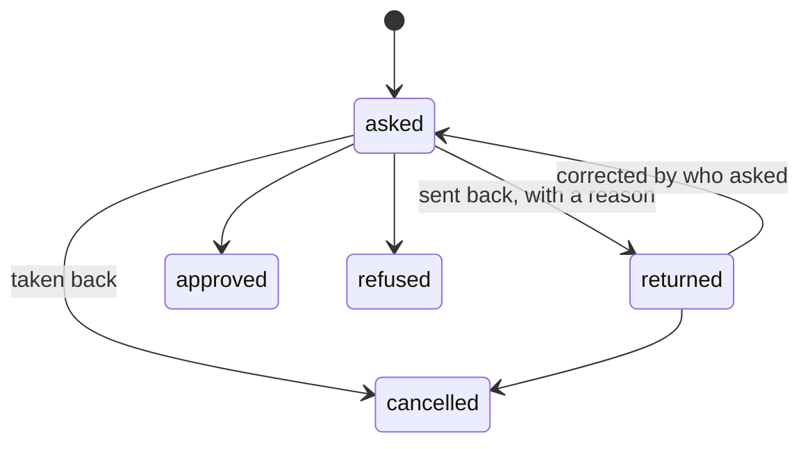

# Leave

Asked with its kind and dates; its working days counted (`src/lib/days.ts`). After the gesture,
`route.ts` asks the center's circuit for `leave`, or decides that it is decided here (no circuit,
no center). The center's answer comes back at `/api/centre/decisions` as an id only; the app reads
the decision with its own token and applies it (`settle-leave`). Never decided by who asked; sent
back with a reason, it is corrected by who asked and decided again.

